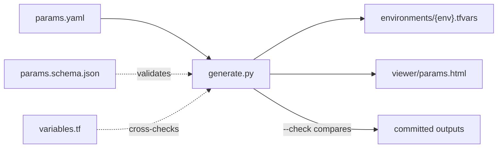

[English](README.md) | [日本語](README.ja.md)

# terraform-params-ssot

Terraform モジュールの環境ごとのパラメータ値を、YAML パラメータシート（`params.yaml`）という単一の正本（SSOT）で管理するツールです。`.tfvars` ファイルと HTML ビュワーを生成し、乖離検知も行えます。

## なぜ作ったか

インフラの現場では、パラメータのドキュメントをスプレッドシートで管理し、実際の値は `.tfvars` ファイルに書くことがよくあります。時間が経つと、この 2 つは乖離してしまいます。

`terraform-params-ssot` は、この二重管理をなくします。

- すべての環境のパラメータ値を 1 つのファイル（`params.yaml`）で管理します。
- `generate.py` が、Terraform 向けの `environments/<env>.tfvars` と人間向けの `viewer/params.html` の両方を生成します。
- 生成時には常に `variables.tf` と既存の `.tfvars` ファイルとの照合を行います。`generate.py --check` を使えば、生成物とコミット済みファイルをバイト単位で比較できるため、pre-commit や CI のゲートとして組み込めます。

## 仕組み



`generate.py` は `params.yaml` を読み込み、構造を検証したうえで `variables.tf` および既存の `.tfvars` ファイルと照合します。その後、決定論的な生成物（順序が固定でタイムスタンプなし）を出力します。`--check` を付けた場合は、メモリ上で生成物を作り、コミット済みファイルとバイト単位で比較します。

## クイックスタート

### 要件

- Python 3.10 以上
- `PyYAML`（必須）:
  ```bash
  pip install pyyaml
  ```
  `generate.py` は起動時に `PyYAML` をインポートするため、未インストールの場合は `--help` を指定しただけでも即座に終了します。
- `jsonschema`（任意）:
  ```bash
  pip install jsonschema
  ```
  `jsonschema` と `params.schema.json` の両方がある場合、`generate.py` は JSON Schema Draft 2020-12 で検証し、さらに組み込みチェック（動的な環境名、パラメータ名の重複、値の型の一致）も実行します。`jsonschema` か `params.schema.json` のどちらかがない場合は、スキーマと同等の組み込み構造チェックにフォールバックし、その旨を表示します。
- ファイルの生成や `--check` の実行に Terraform は不要です。

### 導入

このツールはパッケージとして配布していません。必要なファイルを自分の Terraform モジュールへコピーして使います。

- `generate.py`（一般的には `tools/generate.py` に配置）
- `params.schema.json` を `params.yaml` と同じ場所（通常はモジュールルート）に配置。ジェネレータは、その場所にあるスキーマだけを自動で読み込みます。別の場所に置く場合は `--schema` で指定してください。

次に `variables.tf` と同じ場所に `params.yaml` を作成し（別の場所に置く場合は `--params` を指定）、以下を実行します。

```bash
# regenerate tfvars + viewer
python3 generate.py --tf-dir path/to/module

# drift gate: do not write; exit 1 if committed outputs differ
python3 generate.py --tf-dir path/to/module --check
```

### 付属のサンプルを試す

`example/` は自己完結したデモモジュールです。5 つのパラメータ（`name_prefix`、`tags`、`instance_count`、`enable_detailed_logs`、`allowed_cidr_blocks`）、3 つのグループ（`General`、`App`、`Network`）、3 つの環境（`dev`、`staging`、`prod`）が含まれています。

```bash
cd example
python3 ../generate.py --tf-dir .          # regenerate
python3 ../generate.py --tf-dir . --check  # drift gate
```

生成は決定論的なため、`example/` で再生成してもコミット済みの生成物に差分は出ません。`--check` を実行すると次のように出力されます。

```text
check OK: environments/*.tfvars and viewer/params.html match params.yaml
```

`example/viewer/params.html` をブラウザで開くと、パラメータ一覧表を確認できます。

## 考え方

### 手で編集するものと生成物

- **手で編集するもの:** `params.yaml`
- **生成物（手で編集しない）:** `environments/<env>.tfvars` と `viewer/params.html`

値を変更するときの日常的な流れは次のとおりです。

1. `params.yaml` を編集する。
2. `generate.py` を実行する。
3. `params.yaml`、`environments/*.tfvars`、`viewer/params.html` をまとめてコミットする。

### `variables.tf` も変更する必要があるとき

既存のパラメータの値を変えるだけなら、`params.yaml` だけを編集します。新しいパラメータを追加する場合はコードの変更も必要です。`variables.tf` に変数を追加し、Terraform リソースへ配線したうえで、`params.yaml` にエントリを追加してください。

### 生成物の詳細

- **環境:** 環境名はハードコードされません。`params.yaml` の `environments` に書いた名前と順序がそのまま使われます。
- **ディレクトリ:** 出力時に親ディレクトリが存在しない場合、`generate.py` が必要に応じて作成します。
- **tfvars の整形:** 1 行の代入文は `terraform fmt` と同じように連続する行で `=` の位置を揃えます。複数行の値（map など）は前後の行とは揃えられず、そこから新しい整列グループになります。
- **tfvars のヘッダ:** 生成される `.tfvars` ファイルには、`params.yaml` から `tools/generate.py` で生成したため手動編集しないよう注意書きするヘッダが入ります。スクリプトを別の場所に置いた場合でも、ヘッダのテンプレート内の `tools/generate.py` というパスは固定です。
- **HTML ビュワー:** `viewer/params.html` は日本語のページ（`lang="ja"`）です。フィルタ可能な表に、パラメータ、説明（`description_ja` を優先し、なければ `description` を使用）、環境ごとの有効値が表示されます。環境間で値が異なるセルはハイライトされます。デフォルトと同じ値は控えめなスタイルで表示され、デフォルトにフォールバックしている環境には `（デフォルト）` と付きます。

## CLI リファレンス

| フラグ | デフォルト | 説明 |
|---|---|---|
| `--tf-dir DIR` | `.` | Terraform モジュールのディレクトリ |
| `--params PATH` | `<tf-dir>/params.yaml` | `params.yaml` のパス |
| `--schema PATH` | `params.yaml` と同じ場所の `params.schema.json` | JSON Schema ファイル。デフォルトのパスは、そのファイルが存在しない場合スキップされます。 |
| `--variables PATH` | `<tf-dir>/variables.tf` | 照合に使う Terraform の変数定義ファイル |
| `--tfvars-dir DIR` | `<tf-dir>/environments` | `.tfvars` ファイルの出力先ディレクトリ |
| `--viewer PATH` | `<tf-dir>/viewer/params.html` | HTML ビュワーの出力先パス |
| `--title NAME` | `--tf-dir` のディレクトリ名 | ビュワーに表示するプロジェクト名 |
| `--check` | *(オフ)* | ファイルを書き出さず、コミット済みの生成物と差分があれば終了コード `1` で終了する |
| `-h`, `--help` | — | ヘルプを表示して終了する |

## YAML スキーマ

`params.schema.json` は JSON Schema Draft 2020-12 を使用しており、トップレベルに `additionalProperties: false` を設定しています。

### トップレベル項目

| 項目 | 必須 | ルール |
|---|---|---|
| `environments` | はい | 表示順・生成順に並べた、重複のない環境名のリスト（1 件以上）。各環境名は `^[a-z][a-z0-9_-]*$` に一致する必要があります。 |
| `parameters` | はい | パラメータのリスト（1 件以上）。 |
| `groups` | いいえ | グループ名から `{ label_ja: <空でない文字列> }` へのマップ。HTML ビュワーでの日本語ラベルに使われます。 |

### パラメータの項目

| 項目 | 必須 | ルール |
|---|---|---|
| `name` | はい | `variables.tf` 内の変数名と一致する必要があります。パターンは `^[a-z][a-z0-9_]*$`。 |
| `group` | はい | ビュワーで行をグループ化するための、空でない文字列。 |
| `type` | はい | `string`、`number`、`bool`、`map(string)`、`list(string)`、`any` のいずれか。 |
| `description` | はい | 空でない文字列（英語）。`variables.tf` との照合にも使われます。 |
| `default` | はい | `type` に一致する値。Terraform 変数のデフォルトが `null` の場合は `null` を指定します（`string` は `null` 可、`any` は任意の値を受け付けます）。 |
| `description_ja` | いいえ | 空でない文字列。ビュワーではこちらを優先し、未指定なら `description` にフォールバックします。 |
| `values` | いいえ | `<env>: <value>` のマップ。キーは `environments` に含まれる環境名である必要があります（パターン `^[a-z][a-z0-9_-]*$`）。記載されていない環境は `default` にフォールバックします。 |

### `values` の生成ルール（重要）

あるパラメータが `environments/<env>.tfvars` に書き出されるのは、そのパラメータの `values` に `<env>` が記載されている場合**のみ**です。

- パラメータに `values` がまったくない場合、どの `.tfvars` ファイルにも出力されません。Terraform は `variables.tf` のデフォルト値を使います。
- 一部の環境だけ `values` を設定している場合、それ以外の環境の `.tfvars` ファイルには出力されず、デフォルト値が使われます。
- たとえば `example/params.yaml` の `name_prefix` は `default` のみを持ち `values` がないため、生成されたどの `.tfvars` ファイルにも現れません。

### 最小限の YAML 例

動作する完全なシートは [`example/params.yaml`](example/params.yaml) を参照してください。以下は最小限の有効なシートの例です。

```yaml
environments:
  - dev
  - prod

groups:                  # optional; Japanese labels for the viewer
  Lambda:
    label_ja: Lambda

parameters:
  - name: lambda_memory_size     # must match a variable in variables.tf
    group: Lambda
    type: number                 # string | number | bool | map(string) | list(string) | any
    description: "Lambda memory size in MB (128 - 10240)."
    description_ja: "Lambda のメモリサイズ（MB、128〜10240）。"   # optional; viewer only
    default: 256                 # the variable's default in variables.tf
    values:                      # per-environment overrides; omitted envs use default
      dev: 128
      prod: 512
```

## 乖離検知

乖離検知は 2 層で行います。

### 1. `variables.tf` と既存の `.tfvars` との照合

これは常に実行されます（生成時と `--check` 時の両方）。

**エラー（実行失敗、終了コード `2`）:**

- `params.yaml` にあるパラメータに対応する変数が `variables.tf` に存在しない。
- 既存の `environments/*.tfvars` ファイルで値が代入されている変数が、`params.yaml` に記載されていない。

**警告（メッセージを表示するが、実行は失敗しない）:**

- `params.yaml` と `variables.tf` で `type` が異なる。
- `params.yaml` と `variables.tf` で `description` が異なる。
- `params.yaml` と `variables.tf` で `default` が異なる。
- `variables.tf` に存在する変数が `params.yaml` に記載されていない（常にデフォルト値が使われる）。

### 2. バイト単位のチェック（`--check`）

- ディスクへ書き込まずに、期待される `.tfvars` ファイルと `viewer/params.html` をメモリ上で再生成します。
- 期待される各出力をコミット済みファイルと比較します。ファイルが存在しない場合は空として扱うため、乖離とみなされます。
- 差分があるファイルが 1 つでもあれば、unified diff（各差分の先頭 80 行）を表示したあと `Run generate.py and commit the regenerated files.` と出力し、終了コード `1` で終了します。

### 終了コード

| コード | 意味 |
|---|---|
| `0` | 成功、または `--check` で乖離なし |
| `1` | `--check` で乖離を検出 |
| `2` | `params.yaml` を読み込めない、スキーマ・構造検証に失敗、または照合エラーが発生 |

### CI と pre-commit の設定

以下の例は、`generate.py` を `tools/generate.py` にコピーし、モジュールルート（`params.yaml` と `variables.tf` があるディレクトリ）から実行する前提です。

**pre-commit フレームワーク:**

```yaml
# .pre-commit-config.yaml
repos:
  - repo: local
    hooks:
      - id: params-ssot-check
        name: params.yaml SSOT drift check
        entry: python3 tools/generate.py --check
        language: system
        pass_filenames: false
        files: ^(params\.yaml|variables\.tf|environments/|viewer/)
```

**通常の git フック:**

```bash
#!/bin/sh
# .git/hooks/pre-commit
python3 tools/generate.py --check || {
  echo "params.yaml drift: run generate.py and commit the results" >&2
  exit 1
}
```

**GitHub Actions:**

```yaml
name: params-ssot
on: [push, pull_request]
jobs:
  check:
    runs-on: ubuntu-latest
    steps:
      - uses: actions/checkout@v4
      - uses: actions/setup-python@v5
        with:
          python-version: "3.12"
      - run: pip install pyyaml jsonschema
      - run: python3 tools/generate.py --check
```

## リポジトリ構成

```text
.
├── generate.py            # 生成ツールおよび乖離チェッカー
├── params.schema.json     # params.yaml 用の JSON Schema（Draft 2020-12）
├── example/               # 自己完結したデモモジュール
│   ├── variables.tf
│   ├── params.yaml
│   ├── params.schema.json
│   ├── environments/
│   │   ├── dev.tfvars
│   │   ├── staging.tfvars
│   │   └── prod.tfvars
│   └── viewer/
│       └── params.html
├── README.md              # 英語ドキュメント
├── README.ja.md           # 日本語ドキュメント
└── .gitignore
```

## FAQ と制限

- **`generate.py` は完全な HCL パーサですか？**
  いいえ。`variables.tf` の解析は正規表現ベースで、一般的な 1 行の `type`、`description`、`default` リテラルを扱います。複雑な式は生テキストとして比較されるため警告が出ることがありますが、実行自体は失敗しません。
- **`--check` は `terraform plan` を実行しますか？**
  いいえ。生成した `.tfvars` や HTML ファイルとコミット済みファイルをバイト単位で比較するだけです。Terraform のインストールは不要です。
- **あるパラメータが `viewer/params.html` には出ているのに `.tfvars` にはないのはなぜですか？**
  ビュワーは常に全環境の有効値（上書き値またはデフォルト値）を表示します。一方、`.tfvars` ファイルには、その環境が `values` に含まれているパラメータだけが書き出されます。
- **新しい環境を追加するにはどうすればいいですか？**
  `params.yaml` の `environments` に環境名を追加し、必要に応じて `values` に上書き値を書いたうえで `generate.py` を実行してください。
- **`groups`（`label_ja`）や `description_ja` は Terraform に渡されますか？**
  いいえ。HTML ビュワーの表示だけに使われます。
- **`type: any` は何を受け付けますか？**
  任意の値を受け付けます。

## 由来

実運用の Terraform モジュール（`dev` / `stg` / `prod` の 3 環境で稼働する Kinesis → Lambda → S3 → SQS パイプライン）から抽出したものです。そのモジュールでは、このシートが 3 環境すべてのパラメータの正本になっています。
