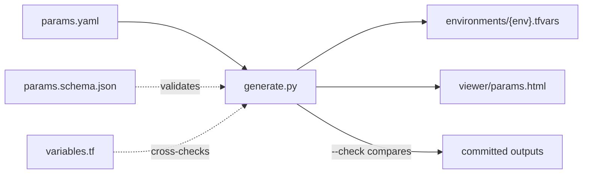

[English](README.md) | [日本語](README.ja.md)

# terraform-params-ssot

A YAML parameter sheet (`params.yaml`) used as the single source of truth (SSOT) for a Terraform module's per-environment values, generating `.tfvars` files and an HTML viewer with drift detection.

## Why

Infrastructure teams often keep parameter documentation in a spreadsheet and the real values in `.tfvars` files. Over time, the two diverge.

`terraform-params-ssot` removes the second copy:

- You keep all environment parameter values in one file: `params.yaml`.
- `generate.py` generates both `environments/<env>.tfvars` (for Terraform) and `viewer/params.html` (for people).
- Generation always cross-checks the sheet against `variables.tf` and any existing `.tfvars` files. `generate.py --check` also byte-compares the generated files with what is committed, so you can use it as a pre-commit or CI gate.

## How it works



`generate.py` reads `params.yaml`, validates its structure, cross-checks it against `variables.tf` and any existing `.tfvars` files, and writes deterministic outputs (stable order, no timestamps). With `--check`, it generates the outputs in memory and byte-compares them to the committed files.

## Quick start

### Requirements

- Python 3.10+
- `PyYAML` (required):
  ```bash
  pip install pyyaml
  ```
  `generate.py` imports PyYAML at startup and exits immediately if it is missing (even for `--help`).
- `jsonschema` (optional):
  ```bash
  pip install jsonschema
  ```
  When both `jsonschema` and `params.schema.json` are present, `generate.py` validates with JSON Schema Draft 2020-12 and also runs built-in checks (for dynamic environment names, duplicate parameter names, and value type matching). If either `jsonschema` or `params.schema.json` is absent, `generate.py` falls back to built-in structural checks equivalent to the schema and prints a note.
- Terraform is not required to generate files or run `--check`.

### Install

This tool is not a package. Copy the files into your Terraform module:

- `generate.py` (commonly `tools/generate.py`)
- `params.schema.json` next to `params.yaml` (usually the module root). The generator only auto-loads the schema from that location. If you keep the schema elsewhere, pass `--schema`.

Then create `params.yaml` next to `variables.tf` (or pass `--params`) and run:

```bash
# regenerate tfvars + viewer
python3 generate.py --tf-dir path/to/module

# drift gate: do not write; exit 1 if committed outputs differ
python3 generate.py --tf-dir path/to/module --check
```

### Try the included example

`example/` is a self-contained module with 5 parameters (`name_prefix`, `tags`, `instance_count`, `enable_detailed_logs`, `allowed_cidr_blocks`), 3 groups (`General`, `App`, `Network`), and 3 environments (`dev`, `staging`, `prod`).

```bash
cd example
python3 ../generate.py --tf-dir .          # regenerate
python3 ../generate.py --tf-dir . --check  # drift gate
```

Because generation is deterministic, regenerating `example/` leaves all committed outputs unchanged, and `--check` prints:

```text
check OK: environments/*.tfvars and viewer/params.html match params.yaml
```

You can also open `example/viewer/params.html` in a browser to inspect the parameter table.

## Concepts

### What you edit vs. what is generated

- **Edit by hand:** `params.yaml`
- **Generated (do not edit by hand):** `environments/<env>.tfvars` and `viewer/params.html`

Day-to-day workflow for value changes:

1. Edit `params.yaml`.
2. Run `generate.py`.
3. Commit `params.yaml`, `environments/*.tfvars`, and `viewer/params.html` together.

### When you must also change `variables.tf`

Changing an existing parameter's value only touches `params.yaml`. Adding a new parameter requires a code change: add the variable to `variables.tf`, wire it into your Terraform resources, and add an entry to `params.yaml`.

### Output details

- **Environments:** Environment names are never hardcoded. They come from `environments` in `params.yaml`, in that order.
- **Directories:** `generate.py` creates parent directories as needed when writing outputs.
- **tfvars formatting:** Single-line assignments align `=` across consecutive lines the way `terraform fmt` does. A multi-line value (such as a map) is not aligned with its neighbors and starts a new alignment group.
- **tfvars header:** Generated `.tfvars` files include a header stating they were generated from `params.yaml` by `tools/generate.py` and should not be edited by hand. That `tools/generate.py` path is hardcoded in the header template even if you put the script elsewhere.
- **HTML viewer:** `viewer/params.html` is a Japanese-language page (`lang="ja"`) with a filterable table of parameters, descriptions (`description_ja` preferred, falling back to `description`), and effective values per environment. Cells highlight when values differ across environments. Values equal to the default use a lighter style, and environments falling back to the default are marked `（デフォルト）`.

## CLI reference

| Flag | Default | Description |
|---|---|---|
| `--tf-dir DIR` | `.` | Terraform module directory |
| `--params PATH` | `<tf-dir>/params.yaml` | Path to `params.yaml` |
| `--schema PATH` | `params.schema.json` next to `params.yaml` | JSON Schema file. The default path is skipped if that file is absent. |
| `--variables PATH` | `<tf-dir>/variables.tf` | Terraform variables file for cross-check |
| `--tfvars-dir DIR` | `<tf-dir>/environments` | Output directory for `.tfvars` files |
| `--viewer PATH` | `<tf-dir>/viewer/params.html` | Output path for the HTML viewer |
| `--title NAME` | `--tf-dir` directory name | Project name shown in the viewer |
| `--check` | *(off)* | Do not write files; exit `1` if committed outputs differ from generated outputs |
| `-h`, `--help` | — | Show help and exit |

## YAML schema

`params.schema.json` uses JSON Schema Draft 2020-12 with `additionalProperties: false` at the top level.

### Top-level fields

| Field | Required | Rules |
|---|---|---|
| `environments` | Yes | Non-empty list of unique names in display and generation order. Each name must match `^[a-z][a-z0-9_-]*$`. |
| `parameters` | Yes | Non-empty list of parameter objects. |
| `groups` | No | Map of group name to `{ label_ja: <non-empty string> }` for Japanese labels in the HTML viewer. |

### Parameter fields

| Field | Required | Rules |
|---|---|---|
| `name` | Yes | Must match a variable in `variables.tf`. Pattern: `^[a-z][a-z0-9_]*$`. |
| `group` | Yes | Non-empty string used to group rows in the viewer. |
| `type` | Yes | One of: `string`, `number`, `bool`, `map(string)`, `list(string)`, `any`. |
| `description` | Yes | Non-empty string (English). Also cross-checked against `variables.tf`. |
| `default` | Yes | Must match `type`. Use `null` when the Terraform variable defaults to `null` (`string` may be `null`; `any` accepts any value). |
| `description_ja` | No | Non-empty string. Viewer prefers this and falls back to `description`. |
| `values` | No | Map of `<env>: <value>`. Keys must be listed in `environments` (pattern `^[a-z][a-z0-9_-]*$`). Environments not listed fall back to `default`. |

### Important generation rule for `values`

A parameter is written to `environments/<env>.tfvars` **only if** `<env>` appears under that parameter's `values`:

- If a parameter has no `values` at all, it is omitted from every `.tfvars` file. Terraform uses the default in `variables.tf`.
- If a parameter sets `values` for only some environments, the other environments' `.tfvars` files omit it and use the default.
- For example, `name_prefix` in `example/params.yaml` has only a `default` and no `values`, so it does not appear in any generated `.tfvars` file.

### Minimal YAML illustration

See [`example/params.yaml`](example/params.yaml) for a full working sheet. Here is a minimal valid sheet:

```yaml
environments:
  - dev
  - prod

groups:                  # optional; Japanese labels for the viewer
  Lambda:
    label_ja: Lambda

parameters:
  - name: lambda_memory_size     # must match a variable in variables.tf
    group: Lambda
    type: number                 # string | number | bool | map(string) | list(string) | any
    description: "Lambda memory size in MB (128 - 10240)."
    description_ja: "Lambda のメモリサイズ（MB、128〜10240）。"   # optional; viewer only
    default: 256                 # the variable's default in variables.tf
    values:                      # per-environment overrides; omitted envs use default
      dev: 128
      prod: 512
```

## Drift detection

Drift detection has two layers.

### 1. Cross-check against `variables.tf` and existing `.tfvars`

This always runs (both when generating and with `--check`).

**Errors (fail the run, exit `2`):**

- A parameter in `params.yaml` has no matching variable in `variables.tf`.
- A variable is assigned in an existing `environments/*.tfvars` file, but is missing from `params.yaml`.

**Warnings (printed, do not fail the run):**

- `type` differs between `params.yaml` and `variables.tf`.
- `description` differs between `params.yaml` and `variables.tf`.
- `default` differs between `params.yaml` and `variables.tf`.
- A variable exists in `variables.tf` but is not listed in `params.yaml` (it always uses its default).

### 2. Byte-for-byte check (`--check`)

- Regenerates all expected `.tfvars` files and `viewer/params.html` in memory without writing to disk.
- Compares each expected output against the committed file. A missing file is treated as empty, so it counts as drift.
- If any file differs, it prints a unified diff (the first 80 lines of each diff), then the line `Run generate.py and commit the regenerated files.`, and exits `1`.

### Exit codes

| Code | Meaning |
|---|---|
| `0` | Success, or `--check` found no drift |
| `1` | `--check` found drift |
| `2` | Cannot load `params.yaml`, schema/structural validation failed, or cross-check errors occurred |

### CI and pre-commit setup

These examples assume you copied `generate.py` to `tools/generate.py` and run from the module root (where `params.yaml` and `variables.tf` live).

**pre-commit framework:**

```yaml
# .pre-commit-config.yaml
repos:
  - repo: local
    hooks:
      - id: params-ssot-check
        name: params.yaml SSOT drift check
        entry: python3 tools/generate.py --check
        language: system
        pass_filenames: false
        files: ^(params\.yaml|variables\.tf|environments/|viewer/)
```

**Plain git hook:**

```bash
#!/bin/sh
# .git/hooks/pre-commit
python3 tools/generate.py --check || {
  echo "params.yaml drift: run generate.py and commit the results" >&2
  exit 1
}
```

**GitHub Actions:**

```yaml
name: params-ssot
on: [push, pull_request]
jobs:
  check:
    runs-on: ubuntu-latest
    steps:
      - uses: actions/checkout@v4
      - uses: actions/setup-python@v5
        with:
          python-version: "3.12"
      - run: pip install pyyaml jsonschema
      - run: python3 tools/generate.py --check
```

## Repository layout

```text
.
├── generate.py            # Generator and drift checker
├── params.schema.json     # JSON Schema (Draft 2020-12) for params.yaml
├── example/               # Self-contained demo module
│   ├── variables.tf
│   ├── params.yaml
│   ├── params.schema.json
│   ├── environments/
│   │   ├── dev.tfvars
│   │   ├── staging.tfvars
│   │   └── prod.tfvars
│   └── viewer/
│       └── params.html
├── README.md              # English documentation
├── README.ja.md           # Japanese documentation
└── .gitignore
```

## FAQ and limits

- **Is `generate.py` a full HCL parser?**
  No. `variables.tf` parsing is regex-based and handles common single-line `type`, `description`, and `default` literals. Complex expressions may be compared as raw text and trigger warnings (which do not fail the run).
- **Does `--check` run `terraform plan`?**
  No. It only byte-compares the generated `.tfvars` and HTML files against the committed files. Terraform does not need to be installed.
- **Why does a parameter appear in `viewer/params.html` but not in `.tfvars`?**
  The viewer always shows the effective value (override or default) for every environment. A `.tfvars` file only includes parameters that list that environment under `values`.
- **How do I add a new environment?**
  Add the name to `environments` in `params.yaml`, add overrides under `values` where needed, and run `generate.py`.
- **Are `groups` (`label_ja`) and `description_ja` sent to Terraform?**
  No. They are only used to render the HTML viewer.
- **What does `type: any` accept?**
  Any value.

## Origin

Extracted from a real Terraform module (a Kinesis → Lambda → S3 → SQS pipeline run across `dev` / `stg` / `prod`), where this sheet is the working parameter source for all three environments.
